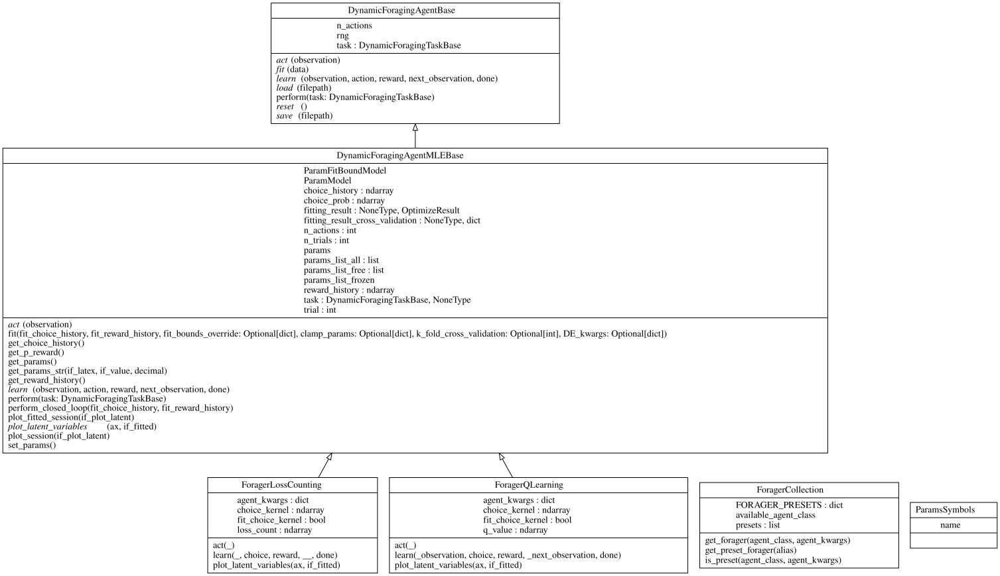

# aind-dynamic-foraging-models

[](LICENSE)

[](https://github.com/semantic-release/semantic-release)


AIND library of models for dynamic foraging tasks: generative agents fitted per session by
maximum likelihood, logistic regression on choice history, hierarchical Bayesian fits across
sessions and subjects, and GLM-HMMs with discrete latent states.

User documentation available on [readthedocs](https://aind-dynamic-foraging-models.readthedocs.io/).

| Model family | Subpackage | Fitting | Extra |
| --- | --- | --- | --- |
| [Generative agents (RL and others)](#reinforcement-learning-rl-models-with-maximum-likelihood-estimation-mle-fitting) | `generative_model` | MLE per session (differential evolution) | `[rl]` |
| [Logistic regression](#logistic-regression) | `logistic_regression` | scikit-learn, with bootstrap | none |
| [Hierarchical Bayesian](#hierarchical-bayesian-fitting) | `hierarchical_bayes` | NUTS in NumPyro, population → subject → session | `[bayes]` |
| [GLM-HMM](#glm-hmm) | `glm_hmm` | EM in dynamax, global fit then per-subject MAP refits | `[glmhmm]` |

## Installation

```bash
pip install aind-dynamic-foraging-models            # logistic regression only
pip install aind-dynamic-foraging-models[rl]        # + generative agents
pip install aind-dynamic-foraging-models[bayes]     # + hierarchical Bayesian fitting
pip install aind-dynamic-foraging-models[glmhmm]    # + GLM-HMM
```

- `[bayes]` needs **Python 3.12+**: every `arviz` 1.x wheel requires it, and `pip` on 3.10 or
  3.11 fails with "No matching distribution found for arviz". `pyproject.toml` explains the pin.
- `[bayes]` and `[glmhmm]` bound `jax` below 0.7, to match the disRNN wrapper's `jax` pin.
  CI tests both extras on Python 3.12, and the core package on 3.10 and 3.11.

To develop the code, clone the repo to your local machine, and run
```bash
pip install -e .[dev]
```


## Reinforcement Learning (RL) models with Maximum Likelihood Estimation (MLE) fitting

### Overview
RL agents that can perform any dynamic foraging task in [aind-behavior-gym](https://github.com/AllenNeuralDynamics/aind-behavior-gym) and can fit behavior using MLE.


### Code structure

- To add more generative models, please subclass [`DynamicForagingAgentMLEBase`](https://github.com/AllenNeuralDynamics/aind-dynamic-foraging-models/blob/11c858f93f67a0699ed23892364f3f51b08eab37/src/aind_dynamic_foraging_models/generative_model/base.py#L25C7-L25C34).

### Implemented foragers


- [`ForagerQLearning`](https://github.com/AllenNeuralDynamics/aind-dynamic-foraging-models/blob/f9ab39bbdc2cbea350e5a8f11d3f935d6674e08b/src/aind_dynamic_foraging_models/generative_model/forager_q_learning.py): Simple Q-learning agents that incrementally update Q-values.
    - Available `agent_kwargs`:
      ```python
        number_of_learning_rate: Literal[1, 2] = 2,
        number_of_forget_rate: Literal[0, 1] = 1,
        choice_kernel: Literal["none", "one_step", "full"] = "none",
        action_selection: Literal["softmax", "epsilon-greedy"] = "softmax",
      ```
- [`ForagerLossCounting`](https://github.com/AllenNeuralDynamics/aind-dynamic-foraging-models/blob/f9ab39bbdc2cbea350e5a8f11d3f935d6674e08b/src/aind_dynamic_foraging_models/generative_model/forager_loss_counting.py): Loss counting agents with probabilistic `loss_count_threshold`.
    - Available `agent_kwargs`:
      ```python
        win_stay_lose_switch: Literal[False, True] = False,
        choice_kernel: Literal["none", "one_step", "full"] = "none",
      ```
- [`ForagerActorCritic`](src/aind_dynamic_foraging_models/generative_model/forager_actor_critic.py): Actor-critic agents. A softmax actor holds a preference per side; a single state-value critic gives the reward baseline.
    - Available `agent_kwargs`:
      ```python
        choice_kernel: Literal["none", "one_step", "full"] = "none",
      ```
- [`ForagerCompareThreshold`](src/aind_dynamic_foraging_models/generative_model/forager_compare_threshold.py): Compare-to-threshold (CTT) agents. One value is compared with a threshold: above it the agent stays, below it the agent switches.
    - Available `agent_kwargs`:
      ```python
        number_of_learning_rate: Literal[1, 2] = 1,
        choice_kernel: Literal["none", "one_step", "full"] = "none",
        reset_to_threshold: Literal[True, False] = True,
      ```
- Action selections ([readthedoc](https://aind-dynamic-foraging-models.readthedocs.io/en/stable/aind_dynamic_foraging_models.generative_model.html#module-aind_dynamic_foraging_models.generative_model.act_functions))

#### Published-model reproductions

[`forager_published_bandits.py`](src/aind_dynamic_foraging_models/generative_model/forager_published_bandits.py)
re-implements published two-armed-bandit models as MLE agents with fixed structure (no
`agent_kwargs`). [`docs/published_bandit_reproductions.md`](docs/published_bandit_reproductions.md)
records each model's equation source, the author code it was checked against, and every
deliberate departure from it.

| Class | Model |
| --- | --- |
| `ForagerFeedbackDependentRL` | Costa: feedback-dependent Rescorla-Wagner |
| `ForagerFeedbackDependentRLBias` | Costa RL plus a fixed choice bias |
| `ForagerFeedbackDependentRLBiasCK1` | Costa dual-rate RL plus bias and Bari's one-step choice kernel |
| `ForagerAlsioRL` | Alsiö et al.: dual-rate RL with one-step spatial stickiness |
| `ForagerLopezDoubleTrace` | López-Yépez et al.: reward value plus fast and slow choice traces |
| `ForagerRLCK` | Chen and Zid: four-parameter RL plus choice kernel |
| `ForagerZidHistoryKernel` | Zid et al.: history-kernel-2 compare-to-threshold foraging RL |
| `ForagerGrossmanMetaLearning` | Grossman et al.: uncertainty-dependent asymmetric meta-learning |
| `ForagerLebedevaPR` | Lebedeva et al.: perseveration / reward-learning (PR) |
| `ForagerBeronRFLR` | Beron et al.: recursively formulated logistic regression (RFLR) |
| `ForagerMillerRHG` | Miller et al.: reward-seeking / habit / gambler's fallacy (RHG) |
| `ForagerEcksteinRL` | Eckstein et al.: asymmetric, counterfactual RL with perseveration |
| `ForagerEcksteinBI` | Eckstein et al.: hidden-state Bayesian inference |

The Findling et al. Weber-imprecision Bayesian-inference model
([`findling_weber.py`](src/aind_dynamic_foraging_models/generative_model/findling_weber.py)) is
not an MLE agent: its likelihood averages over a stochastic belief state with a particle
filter. Fit it with `fit_findling_weber_map` over the 1,000-candidate grid from
`findling_weber_parameter_grid`.


[Here is the list](https://foraging-behavior-browser.allenneuraldynamics-test.org/RL_model_playground#all-available-foragers) of the preset Q-learning and loss-counting foragers (`ForagerCollection`):


### Usage
- [Jupyter notebook](https://github.com/AllenNeuralDynamics/aind-dynamic-foraging-models/blob/main/notebook/demo_RL_agents.ipynb)
- See also [these unittest functions](https://github.com/AllenNeuralDynamics/aind-dynamic-foraging-models/tree/main/tests).

### RL model playground

Play with the generative models [here](https://foraging-behavior-browser.allenneuraldynamics-test.org/RL_model_playground).


## Logistic regression
See [this demo notebook.](https://github.com/AllenNeuralDynamics/aind-dynamic-foraging-models/blob/main/notebook/demo_logistic_regression.ipynb)

### Choosing logistic regression models

#### Su 2022


$$
logit(p(c_r)) \sim RewardedChoice+UnrewardedChoice
$$

#### Bari 2019


$$
logit(p(c_r)) \sim RewardedChoice+Choice
$$

#### Hattori 2019


$$
logit(p(c_r)) \sim RewardedChoice+UnrewardedChoice+Choice
$$

#### Miller 2021


$$
logit(p(c_r)) \sim Choice + Reward+ Choice*Reward
$$

#### Encodings

- Ignored trials are removed

| choice | reward | Choice | Reward | RewardedChoice | UnrewardedChoice | Choice * Reward |
| --- | --- | --- | --- | --- | --- | --- |
| L | yes | -1 | 1 | -1 | 0 | -1 |
| L | no | -1 | -1 | 0 | -1 | 1 |
| R | yes | 1 | 1 | 1 | 0 | 1 |
| L | yes | -1 | 1 | -1 | 0 | -1 |
| R | no | 1 | -1 | 0 | 1 | -1 |
| R | yes | 1 | 1 | 1 | 0 | 1 |
| L | no | -1 | -1 | 0 | -1 | 1 |

Some observations:

1. $RewardedChoice$ and $UnrewardedChoice$ are orthogonal
2. $Choice = RewardedChoice + UnrewardedChoice$
3. $Choice  * Reward = RewardedChoice -  UnrewardedChoice$

#### Comparison

|  | Su 2022 | Bari 2019 | Hattori 2019 | Miller 2021 |
| --- | --- | --- | --- | --- |
| Equivalent to | RewC + UnrC | RewC + (RewC + UnrC) | RewC + UnrC + (RewC + UnrC) | (RewC + UnrC) + (RewC - UnrC) + Rew |
| Severity of multicollinearity | Not at all | Medium | Severe | Slight |
| Interpretation | Like a RL model with different learning rates on reward and unrewarded trials. | Like a RL model that only updates on rewarded trials, plus a choice kernel (tendency to repeat previous choices). | Like a RL model that has different learning rates on reward and unrewarded trials, plus a choice kernel (the full RL model from the same paper). | Like a RL model that has symmetric learning rates for rewarded and unrewarded trials, plus a choice kernel. However, the $Reward $ term seems to be a strawman assumption, as it means “if I get reward on any side, I’ll choose the right side more”, which doesn’t make much sense. |
| Conclusion | Probably the best | Okay | Not good due to the severe multicollinearity | Good |


### Regularization and optimization
The choice of optimizer depends on the penality term, as listed [here](https://scikit-learn.org/stable/modules/generated/sklearn.linear_model.LogisticRegression.html#sklearn.linear_model.LogisticRegression).

- `lbfgs` - [`l2`, None]
- `liblinear` - [`l1`, `l2`]
- `newton-cg` - [`l2`, None]
- `newton-cholesky` - [`l2`, None]
- `sag` - [`l2`, None]
- `saga` - [`elasticnet`, `l1`, `l2`, None]

## Hierarchical Bayesian fitting

`aind_dynamic_foraging_models.hierarchical_bayes` fits the foragers as hierarchical Bayesian
models (population → subject → session) with NumPyro, as a partially-pooled counterpart to
the per-session MLE fitting in `generative_model`.

    pip install aind-dynamic-foraging-models[bayes]

- Two forager likelihoods, chosen by `model=` (`hierarchical_bayes.model.MODELS`):
  `"hattori2019"` (the default) and `"ctt"` (compare-to-threshold).
- `heldout.py` scores a held-out subject: it adapts the subject to its context sessions with
  the population frozen, then scores the subject's test sessions.
- **Start here:** a worked end-to-end example on synthetic data with known ground truth --
  simulate a cohort, fit it both ways, and check that the parameters come back:
  [`notebook/demo_hierarchical_bayes.ipynb`](notebook/demo_hierarchical_bayes.ipynb)
- Design decisions and their rationale: [`src/aind_dynamic_foraging_models/hierarchical_bayes/docs/design-decisions.md`](src/aind_dynamic_foraging_models/hierarchical_bayes/docs/design-decisions.md)
- Validation against the reference Stan implementation, and performance measurements:
  [`src/aind_dynamic_foraging_models/hierarchical_bayes/benchmarks/RESULTS.md`](src/aind_dynamic_foraging_models/hierarchical_bayes/benchmarks/RESULTS.md)

## GLM-HMM

`aind_dynamic_foraging_models.glm_hmm` fits an input-driven HMM with GLM emissions (Ashwood et
al. 2022, *Nat Neurosci* 25:201) over **left / right / ignore** choices, on
[dynamax](https://github.com/probml/dynamax).

    pip install aind-dynamic-foraging-models[glmhmm]

- Two emissions, both exactly normalised over the three outcomes: `hurdle` (per state, an
  engagement GLM on unsigned history and a side GLM on signed history) and `reference`
  (per state, one multinomial GLM with ignore as the zero-logit class, as in Faeze's `ssm`
  fits). How they differ, and which to use:
  [`glm_hmm/README.md`](src/aind_dynamic_foraging_models/glm_hmm/README.md).
- Regressors (`design.py`): RewC and UnrC lags (signed), Ignored and Rewarded lags (unsigned),
  and a bias; trial 0 of every session sees the bias alone.
- Fitting (`model.py`): EM over many variable-length sessions, bucketed by length with exact
  masking. The emission M-step is exact Newton with a Gaussian prior; pi and A use a Dirichlet
  MAP. Priors are arguments, so one model serves a near-flat global fit (`GLOBAL_PRIOR`) and
  per-subject MAP refits started from it (`SUBJECT_PRIOR`). `Prior.mean` centres the weight
  prior, for example on the global fit's weights for a subject refit; the default `None` is zero.
- `fit_with_restarts(..., max_workers=N)` runs EM restarts at once and shares their row
  compression; the GLM-HMM README gives the speed-up on a CPU.
- Scoring: `predictive_log_probs` is the forward filter's one-step-ahead
  log p(y_t | y_<t) per class. It is the held-out quantity, and it never uses later trials.
  `state_posteriors` gives filtered and smoothed posteriors and Viterbi paths.
- `tfp-nightly` is pinned to one build in the extra: dynamax leaves it unpinned, and only some
  nightlies work with jax 0.6.1 and numpy 2.4.
- Device: float64 on the CPU by default; `AIND_GLMHMM_DEVICE=gpu` moves the fits to a GPU.
  GPU linear solves need the CUDA solver libraries pinned, as `model._compute` explains. A
  GPU is faster for a large pooled fit, but not for one mouse's refit.
- Benchmark: `glm_hmm/benchmarks/RESULTS.md` times CPU against V100, A100 and L40S on study
  14's 4.9M-trial cohort, with the scripts to rerun it. The GPU decision is tracked in
  [AllenNeuralDynamics/aind-dynamic-foraging-bfm-wrapper#111](https://github.com/AllenNeuralDynamics/aind-dynamic-foraging-bfm-wrapper/issues/111).
- Validation: `glm_hmm/recovery/` simulates from known parameters and refits them, and
  cross-checks the likelihood against `ssm` (`RESULTS.md`). The study version, including a
  factorial of designed strategies, is
  AllenNeuralDynamics/aind-dynamic-foraging-bfm-studies#50.

## See also
- Foraging model simulation, model recovery, etc.: https://github.com/hanhou/Dynamic-Foraging

## Contributing

### Linters and testing

There are several libraries used to run linters, check documentation, and run tests.

- Please test your changes using the **coverage** library, which will run the tests and log a coverage report:

```bash
coverage run -m unittest discover && coverage report
```

- Use **interrogate** to check that modules, methods, etc. have been documented thoroughly:

```bash
interrogate .
```

- Use **flake8** to check that code is up to standards (no unused imports, etc.):
```bash
flake8 .
```

- Use **black** to automatically format the code into PEP standards:
```bash
black .
```

- Use **isort** to automatically sort import statements:
```bash
isort .
```

### Pull requests

For internal members, please create a branch. For external members, please fork the repository and open a pull request from the fork. We'll primarily use [Angular](https://github.com/angular/angular/blob/main/CONTRIBUTING.md#commit) style for commit messages. Roughly, they should follow the pattern:
```text
<type>(<scope>): <short summary>
```

where scope (optional) describes the packages affected by the code changes and type (mandatory) is one of:

- **build**: Changes that affect build tools or external dependencies (example scopes: pyproject.toml, setup.py)
- **ci**: Changes to our CI configuration files and scripts (examples: .github/workflows/ci.yml)
- **docs**: Documentation only changes
- **feat**: A new feature
- **fix**: A bugfix
- **perf**: A code change that improves performance
- **refactor**: A code change that neither fixes a bug nor adds a feature
- **test**: Adding missing tests or correcting existing tests

### Semantic Release

The table below, from [semantic release](https://github.com/semantic-release/semantic-release), shows which commit message gets you which release type when `semantic-release` runs (using the default configuration):

| Commit message                                                                                                                                                                                   | Release type                                                                                                    |
| ------------------------------------------------------------------------------------------------------------------------------------------------------------------------------------------------ | --------------------------------------------------------------------------------------------------------------- |
| `fix(pencil): stop graphite breaking when too much pressure applied`                                                                                                                             | ~~Patch~~ Fix Release, Default release                                                                          |
| `feat(pencil): add 'graphiteWidth' option`                                                                                                                                                       | ~~Minor~~ Feature Release                                                                                       |
| `perf(pencil): remove graphiteWidth option`<br><br>`BREAKING CHANGE: The graphiteWidth option has been removed.`<br>`The default graphite width of 10mm is always used for performance reasons.` | ~~Major~~ Breaking Release <br /> (Note that the `BREAKING CHANGE: ` token must be in the footer of the commit) |

### Documentation
To generate the rst files source files for documentation, run
```bash
sphinx-apidoc -o docs/source/ src
```
Then to create the documentation HTML files, run
```bash
sphinx-build -b html docs/source/ docs/build/html
```
More info on sphinx installation can be found [here](https://www.sphinx-doc.org/en/master/usage/installation.html).
